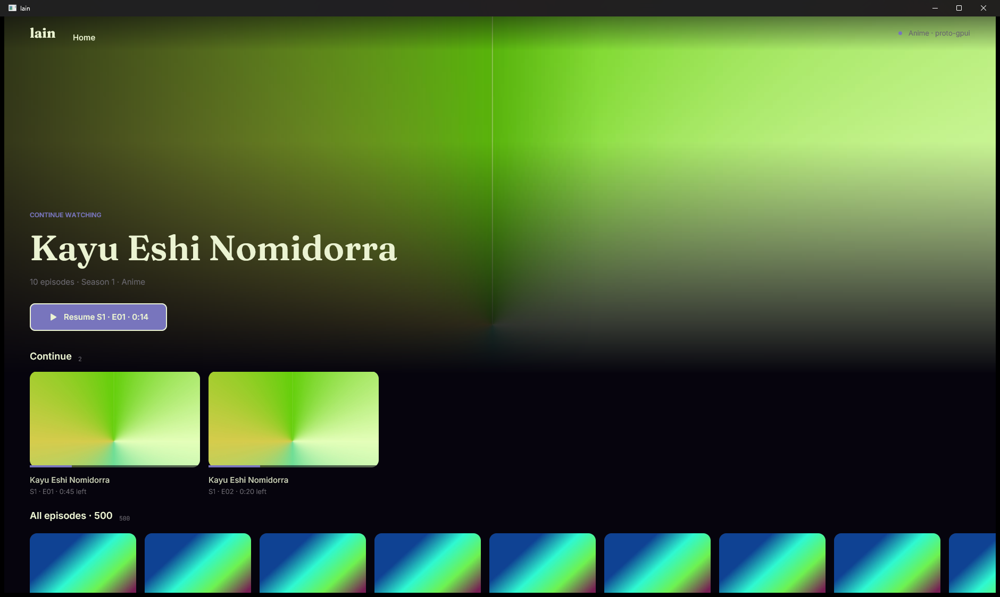
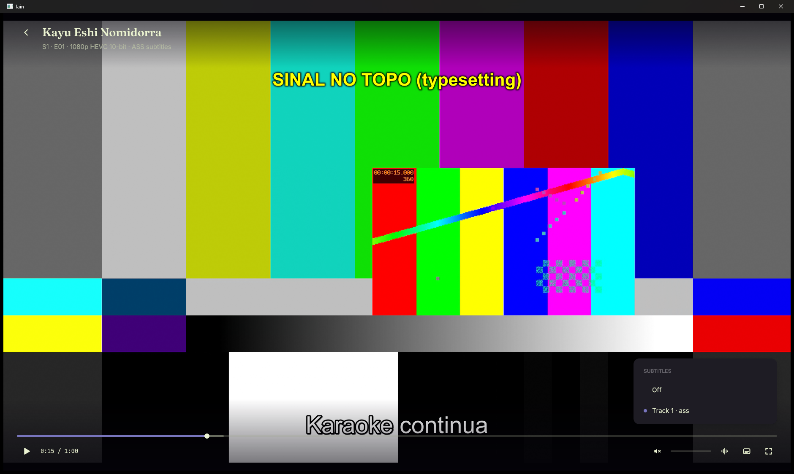

# lain desktop prototype: GPUI (P2b)

The two screens from `D:\lain-proto\BRIEF.md` (DESIGN-v2 §8.2, V-13) built
on [GPUI](https://crates.io/crates/gpui):
- **Home:** a quiet top bar, a title-first hero, and horizontal rails over the
  whole 500-item catalog.
- **Player:** libmpv rendering inside the window, with GPUI's own controls on
  top.

Everything that talks to the server goes through `lain-client`.




## Build and run

Build natively on Windows with MSVC and Windows SDK 26100. Build output goes to
`C:\lain-proto-target\gpui` (set in `.cargo/config.toml`).

```sh
cargo build --release          # or plain `cargo build`
```

`build.rs` links `mpv.lib` from `D:\lain-proto\libmpv` (override it with
`LAIN_MPV_DIR`) and copies `libmpv-2.dll` next to the exe.

GPUI's build script found `fxc.exe` in `Windows Kits\10\bin\10.0.26100.0\x64` on
its own, so no environment variable is needed. `GPUI_FXC_PATH` overrides it.

**Run:** `dist\lain-desktop-gpui.exe` (double-click). The defaults are:
`--shared D:\lain-proto\shared`, `--media D:\lain-proto\media`,
`--theme <shared>\theme.json`, `--account <shared>\conta-gpui.txt`, and the
server taken from the account file.

Other flags:
- `--theme <file>`: a theme file. It is reloaded live when the file changes.
- `--mute`: mpv `ao=null` + `mute=yes`, set before `mpv_initialize`. The log
  then shows `current-ao=null`. `--bench` implies it.
- `--window-pos X,Y` / `--window-size WxH`: an exact window rect in physical
  virtual-desktop pixels. GPUI gets those bounds and the display containing the
  point, with `focus: false`. The window is created hidden, moved, then shown
  with `SW_SHOWNA` (no activation). See "Window placement" below.
- `--log <file>`: stderr to a file (the release exe has no console).
- `--server <url>`
- `--bench <out.json>`: unattended benchmark (see below).
- `--demo rail|player-4k|player-subs|menu-subs`: puts the app in a state for
  screenshots without any simulated input.
- `tools\shot.ps1 <process> <out.png>`: captures one window with `PrintWindow`.
  It does not focus the window or send any input.

Test runs on the shared machine go only through
`D:\lain-proto\tools\rodar-teste.ps1`. It adds `--mute` and the built-in
panel's rect.

### Window placement on Windows (what was needed)

GPUI 0.2.2 does not honor a requested origin on a secondary monitor:
- `WindowOptions.window_bounds` and `display_id` are checked against the
  display with mixed DPI scale factors. On this machine the check failed, so
  GPUI fell back to the default bounds on the primary monitor.
- With `show: false`, the first `ShowWindow` re-applies that placement.

What the prototype does:
1. Creates the window hidden.
2. Subclasses it and moves it with `SetWindowPos`.
3. Shows it with `SW_SHOWNA`.
4. For the first ~2 s, pins the position in `WM_WINDOWPOSCHANGING`. Two moves
   to the primary monitor arrive right after showing (logged as `pinned: ...`).
   The coordinator traced these to the owner's tiling window manager, which
   adopts new windows. After the pin is released, normal moves and fullscreen
   work.

mpv's video window is a child window, so it always follows.

`dist/` is git-ignored: the exe is a build artifact and the DLL is 124 MB.
Rebuild with `cargo build --release`, then copy `lain-desktop-gpui.exe` and
`libmpv-2.dll` from `C:\lain-proto-target\gpui\release`.

### Controls

**Home:**
- ←/→ move along a rail. ↑/↓ move between rails and the hero's Play button.
  Enter/Space open. Home/End jump to the ends. PgUp/PgDn scroll the page.
- Mouse: hovering focuses a card. The vertical wheel over a rail's cards
  scrolls that rail sideways; over the hero, the headers or the left margin it
  scrolls the page. Shift+wheel and a touchpad's horizontal scroll also scroll
  the rail. Dragging a rail scrolls it with a short fling. A click opens.

**Player:**
- Keys: Space/K play/pause, ←/→ ±5 s, ↑/↓ volume, M mute, F fullscreen, Esc
  (closes the menu, then leaves fullscreen, then goes back to Home).
- Mouse: click the video to pause, double-click for fullscreen. Drag the seek
  bar to scrub (keyframe seeks while dragging, an exact seek on release).
  Drag the volume bar. Audio and subtitle menus. The controls auto-hide after
  `player.autohide_ms`.

**Continue:**
- The player saves progress every 5 s, on close and when the window closes.
- Home's Continue row refetches when the event stream sends
  `progress-changed`.
- Opening an item resumes from the server's progress.
- Even episodes play the 4K file; odd episodes play the 10-bit file.

## mpv integration (the key result)

**What works:** mpv uses `wid` to render into a child HWND that sits under
GPUI's transparent DirectComposition surface.

GPUI 0.2.2 on Windows renders with **Direct3D 11 into a DirectComposition
swap chain**:
- `CreateTargetForHwnd(hwnd, topmost = TRUE)`.
- A premultiplied-alpha swap chain, cleared to transparent every frame.
- The window has `WS_EX_NOREDIRECTIONBITMAP`.

"Topmost" means DWM composites GPUI's visual *above the window's child
windows*. So the prototype does this:
1. Creates a child window covering the client area, at the bottom of the
   z-order (`mpv::VideoHost`). It is `WS_DISABLED`, so hit testing skips it and
   every mouse event over the video still reaches GPUI's window. mpv's own
   window inside it is disabled too.
2. Hands that window to mpv as `wid`, with `vo=gpu-next`, `gpu-api=d3d11`,
   `hwdec=auto-safe`. mpv presents its own D3D11 flip-model swap chain there.
3. Draws the Player view with **no background**. Wherever GPUI paints nothing,
   the video shows through, and the controls (gradient scrims, seek bar, menus)
   blend over it with real alpha.

**Result:**
- **Overlays are correct.** Translucent gradients and the menu panel sit over
  moving video with no flicker.
- **No tearing.** DWM composes both surfaces.
- **No copies.** Video frames never pass through the UI thread or GPUI's
  renderer. mpv runs at the video rate on its own; GPUI redraws only when the
  controls change, and not at all while they are hidden.
- **Screen captures work.** `PrintWindow(PW_RENDERFULLCONTENT)` captures video
  and overlay together (see `shots/`).

**Pitfalls hit, and how they were handled:**
- **Deadlock.** `mpv_initialize` and `mpv_terminate_destroy` create and destroy
  mpv's window on mpv's thread, and those calls send messages to our host
  window. Running them on the UI thread deadlocks. Both run on GPUI's
  background executor while the UI thread keeps pumping messages. The host
  window is destroyed only after mpv is gone. A player closed while mpv is
  still starting is parked and torn down when the start finishes.
- **Desktop showing through.** The window has no redirection bitmap, so before
  mpv's first frame the host shows the desktop. The Player paints black until
  `vo-configured`.
- **The test file's ASS track has no default flag.** The player sets `sid=1`
  so subtitles show.
- **Sizing:** the host follows the parent's client rect on every Player frame
  and on a 33 ms tick (covers resize and fullscreen).

**Considered and not used:**
- **The render API into a GPUI texture.** GPUI exposes no texture or surface
  hook (it would need a fork). libmpv's render API has only OpenGL and software
  backends: no D3D11. That means a WGL/DX interop or ANGLE layer, plus a GPUI
  patch, for no gain over the DWM path.
- **A separate layered window for the controls.** It isn't needed, because
  GPUI's own surface already composes over child windows with alpha.

**Size:** `src/mpv.rs` is about 430 lines: the hand-written FFI for the 13
libmpv calls used, the event thread and state, and the host window. About 150
more lines in `src/player.rs` handle the start and shutdown lifecycle. The rest
of `player.rs` is the controls UI.

**Limitations:**
- The cursor is not hidden when the controls hide. GPUI 0.2.2 has no
  hidden-cursor style; a Win32 `SetCursor(NULL)` hack would be needed.
- mpv draws subtitles at the bottom of the video, so they can sit under the
  control bar while it is visible.
- This approach is Windows-specific. Linux and macOS need their own variant:
  X11 child windows or Wayland subsurfaces under GPUI, or a GPUI patch for an
  external texture.

## Theme coverage (`shared/theme.json`)

| Key | Status | Notes |
|---|---|---|
| `name` | honored | logged on reload |
| `colors.bg` / `surface` / `text` / `muted` / `accent` / `danger` / `scrim` | honored | `danger` only shows on errors; `scrim` is the top bar on scroll |
| `fonts.ui` / `display` / `mono` | honored | Inter, Fraunces and JetBrains Mono are bundled (OFL, latin subsets). A missing family falls back to Segoe UI, Georgia or Cascadia Mono. DirectWrite lists the bundled Fraunces as "Fraunces NonWonky", so families resolve by prefix. |
| `fonts.size_base` | honored | every text size derives from it |
| `radius.card` / `radius.button` | honored | |
| `spacing` | honored | margins, gaps and padding use the scale by index |
| `rail.card_w` / `card_h` / `gap` | honored | landscape sizes switch the cards to backdrop art |
| `rail.hover_scale` | honored, by layout | GPUI has no element transforms, so the card's layout box grows around its centre (animated). Text under the card does not scale. |
| `hero.height` | honored | fraction of the window height |
| `hero.gradient` | partial | GPUI's `linear_gradient` takes two stops. The first and last stops are used; middle stops are ignored. |
| `hero.blur` | honored, at decode time | GPUI has no blur filter for elements, so the backdrop is blurred on the CPU (background thread, quarter resolution) when decoded. It cannot animate. |
| `motion.fast_ms` / `normal_ms` | honored | fast: focus and hover, showing controls. normal: scrolling, fades, hiding controls. |
| `motion.easing` | honored | `linear`, `ease-in-cubic`, `ease-in-out-cubic`, `ease-out-quad`, `ease-out-expo`, `ease-out-cubic` (also the default for unknown names), and `spring` (an underdamped curve) |
| `player.controls_bg` / `seek_h` / `autohide_ms` | honored | |

**Live reload works.** The app checks the theme file's modification time every
0.5 s and re-renders (tested by swapping `theme.json` for `theme-alt.json` while
running; see `shots/live-reload-after.png`). Fonts are re-resolved on reload.
Images that depend on the theme (sizes, blur) are re-decoded under new cache
keys.

## Bench (`--bench out.json`)

The run logs in and waits for the first Home frame with the hero and the
visible posters drawn (`cold_start_ms` is measured from the process creation
time, `GetProcessTimes`). Then it:
1. Records the working set (`rss_mb_home`).
2. Scrolls the 500-card rail end to end at 2400 px/s.
3. Opens the 4K file, then the 10-bit file, for 20 s each, from 0 s with the
   controls forced visible. `rss_mb_player_4k` is taken at 15 s.
4. Writes the JSON and exits.

How frame times are measured:
- `scroll_frame_ms` and `ui_frame_ms_during_video` are the intervals between
  successive GPUI frames (one root render per presented frame). The app keeps
  requesting animation frames during measurement, so the interval is vsync-bound
  and a slow frame shows up as a long gap.
- `scroll_build_ms` is the CPU time of the root render (element tree build)
  per frame.
- The mpv numbers are read from mpv's properties at the end of each file.

**Results:** pending. GUI runs were on hold (window-manager issue) when this
was written; see the PR for the numbers once run.

## Line counts

`wc -l`. The total is 3,392 lines including `build.rs`; 3,133 of them are
non-blank. There is no markup: the whole UI is Rust.

| File | Lines | What |
|---|---|---|
| `src/main.rs` | 680 | app, args, assets, theme reload, ticking, window placement |
| `src/home.rs` | 834 | Home, layout, virtualized rails, input |
| `src/player.rs` | 637 | Player controls and the mpv session lifecycle |
| `src/mpv.rs` | 427 | libmpv FFI, event thread, the video host window |
| `src/images.rs` | 87 | off-thread decode, resize and blur, cache |
| `src/theme.rs` | 244 | theme file, colors, easing |
| `src/backend.rs` | 151 | lain-client: login, catalog, continue, progress, events |
| `src/bench.rs` | 307 | `--bench` and `--demo` |
| `build.rs` | 25 | link libmpv, copy the DLL |

## Size and build time

- **Release exe:** 14.9 MB. It is stripped, with thin LTO, and the fonts and
  icons are embedded. `libmpv-2.dll` (124 MB) ships next to it.
- **Clean release build:** 253 s with `-j 6`, while two other prototypes were
  compiling on the same machine. Incremental release rebuilds take about 60 s.
  Most of the time goes to gpui and its dependencies.

## Dependencies (direct)

| Crate | Why |
|---|---|
| `gpui` =0.2.2 (crates.io) | the UI framework. The crates.io release builds as-is on Windows with Rust 1.99, so no zed git pin is needed. It is from Oct 2025, about a year behind zed's main. |
| `lain-client` (path) | every server call |
| `tokio` | `lain-client` is async on tokio. A two-thread runtime runs it, and GPUI's executors await its `JoinHandle`s and channels. |
| `serde`, `serde_json` | theme file, `series.json`, bench output |
| `image` (jpeg only) | art decode, resize and blur off the UI thread (GPUI already depends on it) |
| `windows` 0.61 | the child host window, process times. Same version and features GPUI already compiles. |
| `raw-window-handle` | getting the HWND from GPUI's `Window` |

gpui-component / gpui-kit is **not** used: plain `div`, `img`, `svg` and
`canvas` were enough. libmpv has no bindings crate here; the FFI is
hand-written.

## What was hard / GPUI notes

- **No transforms, no blur, two-stop gradients, no hidden cursor.**
  - Card hover scale is done by resizing layout boxes.
  - Blur happens at image decode time.
  - Only the outer gradient stops are used.
- **Images:** GPUI samples images without mipmaps. Drawing a 600x900 poster at
  200x300 shimmers, so art is pre-resized to its drawn size times the display
  scale in a custom cache instead of using `img(path)`.
- **Rails:** a plain overflow-scroll div with 500 children would rebuild all
  500 every frame (GPUI rebuilds the element tree per frame), so the rails are
  virtualized by hand. Smooth motion (theme durations and easing) is the
  prototype's own animation, not GPUI's scroll.
- **Mouse handling:** hover-only mouse-move listeners mean drag and hit testing
  were simpler to do at the root with the prototype's own layout model.
- **Fonts:** DirectWrite groups the bundled static Fraunces under a "NonWonky"
  family name. `all_font_names()` shows it, but a lookup by "Fraunces" alone
  silently falls back.
- **API churn:** the crates.io gpui (0.2.2) lags zed's main by a year.
  gpui-component 0.9 depends on `gpui-pre`, a third-party republish of a newer
  gpui, which is another reason it was not used.
- **Framework bugs hit:** none that blocked the work. The only surprise was the
  font family naming above.
